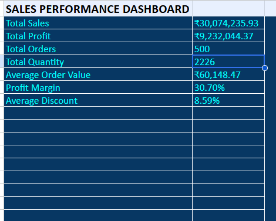
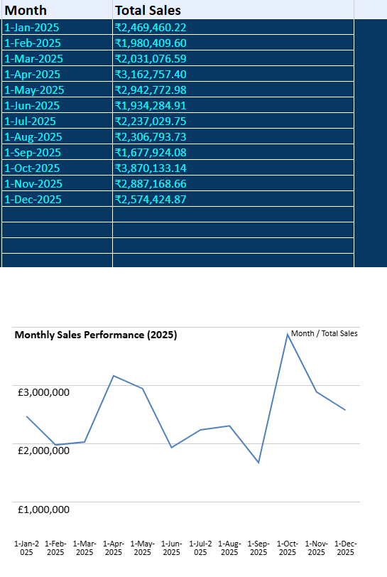
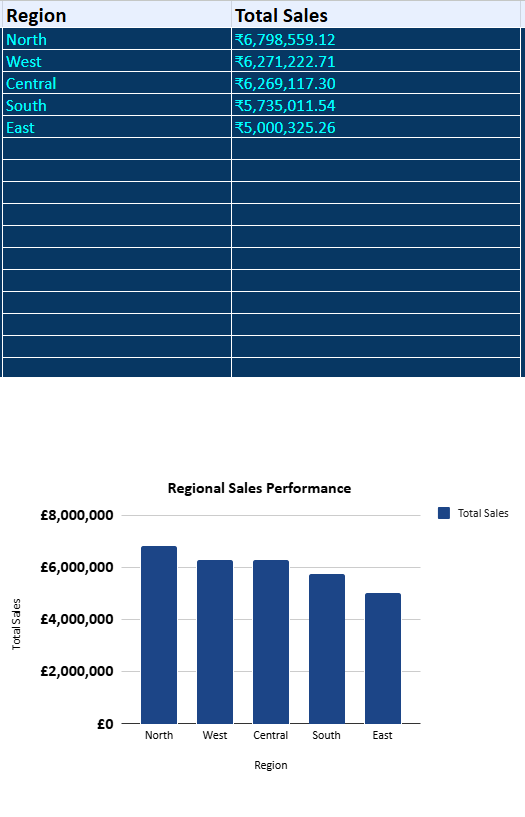
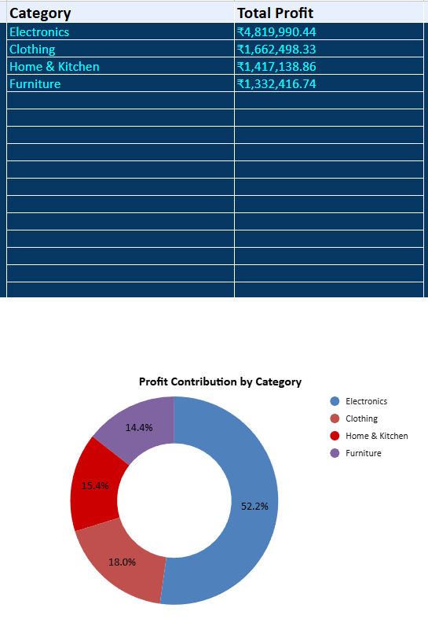
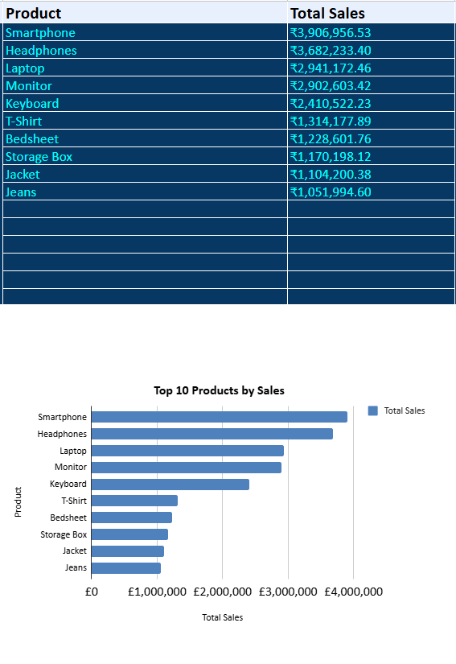
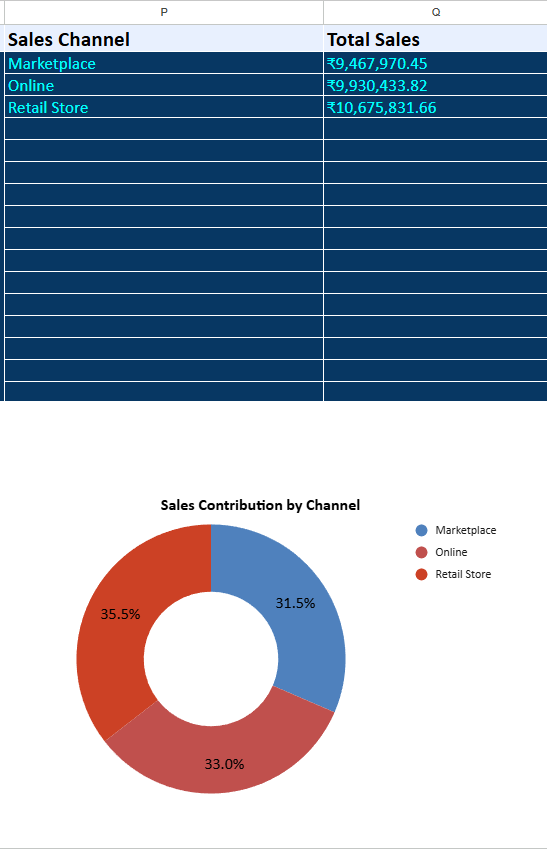
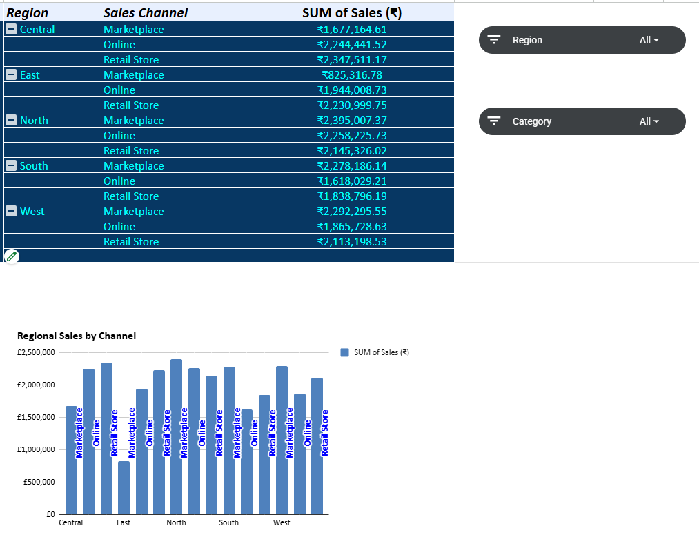

# Retail Sales Performance Analytics

## Project Overview
This project focuses on analyzing retail sales data to understand business performance, sales trends, profitability, product performance, and customer purchasing channels.

An interactive Sales Performance Dashboard was created using Google Sheets to present key business insights through KPIs, charts, and visualizations.

## Project Objectives
- Analyze overall retail sales and profit.
- Identify monthly sales trends.
- Compare sales performance across regions.
- Analyze profit contribution by product category.
- Identify the top 10 products based on sales.
- Understand sales contribution across different channels.
- Build an interactive dashboard for business insights.

## Key Performance Indicators (KPIs)

| KPI | Value |
|---|---:|
| Total Sales | ₹30,074,235.93 |
| Total Profit | ₹9,232,044.37 |
| Total Orders | 500 |
| Total Quantity | 2,226 |
| Average Order Value | ₹60,148.47 |
| Profit Margin | 30.70% |
| Average Discount | 8.59% |

## Dashboard Analysis

### 1. Sales Performance KPIs
Provides an overview of total sales, total profit, orders, quantity, average order value, profit margin, and average discount.

### 2. Monthly Sales Performance
Analyzes monthly sales trends for 2025 and identifies changes in sales throughout the year.

### 3. Regional Sales Performance
Compares sales across five regions: North, West, Central, South, and East.

### 4. Profit Contribution by Category
Shows the contribution of different product categories to total profit.

### 5. Top 10 Products by Sales
Highlights the top-performing products based on total sales.

### 6. Sales Contribution by Channel
Analyzes sales distribution across Marketplace, Online, and Retail Store channels.

### 7. Regional Sales by Channel
Compares sales channel performance across different geographical regions.

## Key Business Insights

- Total sales reached approximately ₹30.07 million.
- Total profit was approximately ₹9.23 million.
- North recorded the highest regional sales.
- Electronics contributed the largest share of category profit.
- Smartphone was the highest-selling product.
- Retail Store generated the highest sales among the three channels.
- October recorded the highest monthly sales in 2025.

## Tools & Technologies
- Google Sheets
- Pivot Tables
- Charts and Data Visualization
- Data Analysis
- Interactive Dashboard
- Slicers and Filters

## Conclusion
This project demonstrates how retail sales data can be transformed into meaningful business insights using data analytics and visualization techniques.

The dashboard helps understand sales performance, identify profitable categories, compare regions, and evaluate different sales channels for better business decision-making.

---

**Project:** Retail Sales Performance Analytics  
**Created by:** Reyan Reza  
**GitHub:** [ReyanReza3126](https://github.com/ReyanReza3126)
